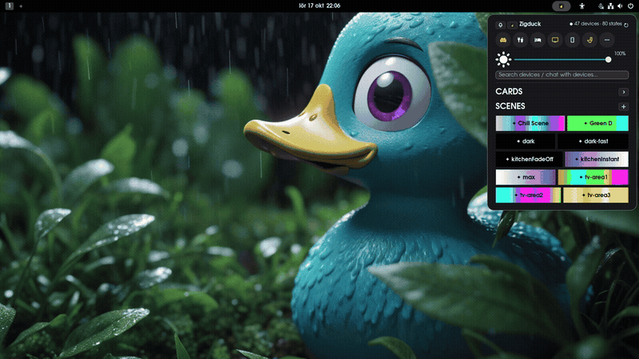

# **zigduck**

[ "")](https://github.com/sponsors/QuackHack-McBlindy) [](https://buymeacoffee.com/quackhackmcblindy)

<br>



<!-- VERSIONS_START -->


<!-- VERSIONS_END -->


# **zigduck-gnome-shell-extension**

**This  is a smart home GNOME desktop widget for <a href="https://github.com/QuackHack-McBlindy/zigduck">Zigduck</a>.**

Control your entire smart home with this handy Zigduck widget in the top bar.<br>
**Zigduck** is a complete home automation system for NixOS.<br>
Using this extension you can see and control Zigbee & Philips Hue (+Sync Box) devices, Android TVs, fetch, build and display EPG/TV-Guide, copy current lights state and create a Nix expression & copy it straight to clipboard.<br>
Extension uses clipboard only for copying that. There are no extension settings, all configuration comes from your Nix code.<br>
Create custom (non-zigbee) devices for monitoring and controlling and wire your own automations.<br>
This extension also provides a chat interface and users may write their own natural language commands (no LLM).<br>

**Define once, deploy forever.**

**zigduck** uses smart defaults, after defining your rooms & devices --<br>
most users don’t need to write any automations at all.<br>
Lights, dimmers, motion sensors - it should all work as expected **out of the box**.<br>
**Everything** is configurable via NixOS options.<br>


```markdown
            Nix
             │
             ▼
          zigduck
             │
      ┌──────┴──────┐
      ▼             ▼
    MQTT         REST API
      │             │
      ▼             ▼
 zigbee2mqtt    adb/media
      │             │
      └──────┬──────┘
             ▼
          Devices
```

<br>
<br>

## **Installation**

https://extensions.gnome.org/extension/11365/zigduck-smart-home/

<br>

## **License**

This project is licensed under the terms of the MIT license.<br>
See the `LICENSE` file in the repository for full details.<br>

Contributions are welcomed.
